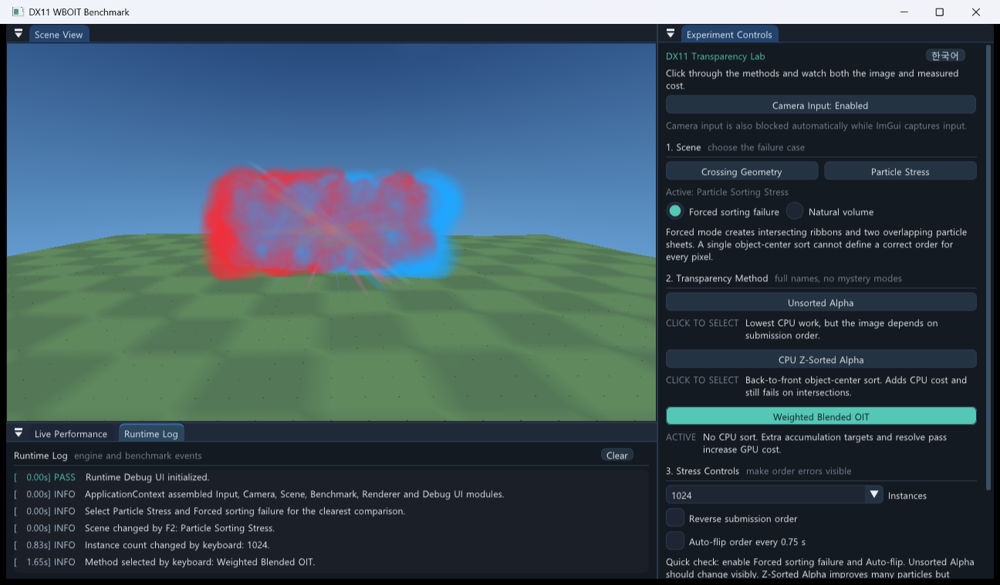

<div align="center">

# Dev Exploration Lab

**게임 개발의 질문을 코드와 측정으로 확인하는 실험실**

Reproducible experiments in game development, graphics, and developer tooling.


[](https://github.com/Cocode96/Dev-Exploration-Lab/discussions)

[대표 실험](#대표-실험) · [개발 도구](#개발-도구) · [연구 흐름](#연구-흐름) · [질문하기](https://github.com/Cocode96/Dev-Exploration-Lab/discussions/categories/q-a) · [English](#english)

</div>

## 처음 오셨다면

게임 클라이언트 프로그래머의 관점에서 C++, DirectX, 렌더링 구조와 개발 도구를 직접 구현하고 측정합니다. 코드만 나열하지 않고 **질문, 비교 조건, 원시 결과, 결론과 한계**를 함께 남깁니다.

| 보고 싶은 것 | 시작할 곳 |
|---|---|
| 화면으로 확인하는 그래픽스 실험 | [DX11 WBOIT 벤치마크](experiments/cpp/dx11-wboit-benchmark/README.md) |
| CPU와 GPU를 선택하는 판단 근거 | [작은 Update의 병렬 처리 손익분기점](questions/game-development/q005-update-parallel-break-even/README.md) |
| 렌더러 모듈 구조와 전환 비용 | [런타임 렌더러 DLL 비교](questions/game-development/q004-runtime-renderer-dll-swap/README.md) |
| 재사용할 수 있는 실행 도구 | [Binary Packer](tools/sb-packer/README.md) · [Python benchmark runner](experiments/python/benchmark-runner/README.md) |

## 대표 실험

### 01. DX11 투명 렌더링 비교

동일한 3D 장면에서 일반 알파 블렌딩, CPU 중심점 Z 정렬, **Weighted Blended OIT**를 비교합니다. Dear ImGui 작업 화면에서 장면과 방법을 바꾸고 CPU/GPU 비용을 확인할 수 있습니다.

[](experiments/cpp/dx11-wboit-benchmark/README.md)

- **확인하는 질문:** 투명 오브젝트의 제출 순서를 뒤집어도 화면을 유지할 수 있을까? 그때 드는 비용은 얼마일까?
- **남긴 근거:** 실행 코드, 측정 CSV, 같은 카메라의 정방향·역방향 이미지, 비교 보고서
- **해석의 범위:** 실제 게임 리소스를 사용하지 않은 독립 합성 장면입니다. WBOIT의 순서 민감도 감소와 GPU 비용 증가를 함께 다루며, 실제 게임의 성능 개선으로 일반화하지 않습니다.

[실행 방법과 구조](experiments/cpp/dx11-wboit-benchmark/README.md) · [측정 결과와 시각 비교](experiments/cpp/dx11-wboit-benchmark/reports/reference/2026-09-02-rtx5060-forced-sorting-stress/SUMMARY.md)

### 02. 작은 Update의 병렬 처리 손익분기점

동일한 위치·회전·수명·World 행렬 갱신을 CPU 단일 스레드, 고정 작업 스레드 풀, DX11 Compute Shader로 수행합니다.

- 64개부터 262,144개까지 작업량을 바꿔 비교합니다.
- GPU Kernel 시간과 제출·완료 대기 시간을 구분합니다.
- 작은 작업에서는 계산보다 분배와 동기화 비용이 커질 수 있음을 확인합니다. 수치는 기록된 측정 환경에 한정합니다.

[질문과 결론](questions/game-development/q005-update-parallel-break-even/README.md) · [실험 코드](experiments/cpp/dx11-update-break-even/README.md) · [원본 CSV](experiments/reports/raw_results.csv)

### 03. 런타임 렌더러 DLL 교체

백엔드별 DLL을 교체하는 구조와 하나의 DLL 내부에서 전환하는 구조를 비교합니다. 전환 비용뿐 아니라 배포, 리소스 수명과 유지보수 관점도 함께 검토합니다.

- 준비 실행 후 구조별 30회 측정하고 A/B 실행 순서를 혼합했습니다.
- 원시 측정값과 실제 렌더러의 최소 구현을 구분해 기록합니다.
- DLL 마이크로벤치마크 수치를 실제 게임의 렌더러 전환 시간으로 해석하지 않습니다.

[질문과 결론](questions/game-development/q004-runtime-renderer-dll-swap/README.md) · [렌더러 실험](experiments/cpp/windows/dll/q004-runtime-renderer-swap/README.md) · [원본 CSV](experiments/python/benchmark-runner/reports/q004-dll-architecture-comparison/raw_results.csv)

## 개발 도구

| 도구 | 하는 일 | 바로가기 |
|---|---|---|
| **Binary Packer** | 파일명·크기·원본 바이트를 `.sb` 컨테이너로 저장하는 C++ 도구 | [소스와 사용법](tools/sb-packer/README.md) · [실행 파일](https://github.com/Cocode96/Dev-Exploration-Lab/releases/tag/binary-packer-v1.1.0) |
| **Python benchmark runner** | 워밍업, 반복 실행, 실행 순서 제어, CSV 기록 | [설정과 실행 방법](experiments/python/benchmark-runner/README.md) |

재사용하는 개발 도구는 `tools/`에 모읍니다. 기존 benchmark runner는 `experiments/python/benchmark-runner/`에 유지합니다.

## 연구 흐름

```text
Question → Hypothesis → Experiment → Measurement → Conclusion → Application
```

1. [Discussions](https://github.com/Cocode96/Dev-Exploration-Lab/discussions/categories/q-a)에 질문과 현재 가설을 남깁니다.
2. 비교 조건, 측정 지표와 예상 결과를 정합니다.
3. 실행 코드, 환경과 원시 결과를 보존합니다.
4. 결론과 한계를 기록하고, 실제 프로젝트에 적용했다면 적용 근거를 연결합니다.

실패한 가설도 보존합니다. 동일한 조건에서 결과를 재현하고 다음 판단에 사용할 수 있는 기록을 지향합니다.

### 다루는 주제

- C++, DirectX, 렌더링 구조와 그래픽스 최적화
- Unity와 게임 클라이언트 구조
- Python 기반 측정 도구와 개발 자동화
- AI Agent와 게임 개발 AX 파이프라인
- 객체 모델, 메모리와 운영체제 등 구현에 연결되는 CS 주제

주제 목록은 관심 범위이며, 현재 구현과 측정 결과는 위의 대표 실험에서 확인할 수 있습니다.

## 저장소 구조

```text
experiments/
  cpp/           DirectX와 C++ 실험
  python/        반복 측정 도구
  reports/       원시 측정값과 요약 결과
questions/       검증한 질문, 해석과 한계
tools/           재사용하는 개발 도구
```

실험별 실행 환경과 빌드 방법은 각 폴더의 README에 있습니다. 전체 질문은 [질문 인덱스](questions/README.md)에서 볼 수 있습니다.

## 공개 협업

- 질문과 초기 가설은 Discussion에서 나눕니다.
- 반례, 공식 문서, 프로파일링 결과와 재현 가능한 코드를 환영합니다.
- 문서와 실험 변경은 작업 브랜치 또는 fork에서 PR로 제안합니다.
- `main` 직접 push와 force push는 허용하지 않습니다.
- 자세한 기준은 [기여 가이드](CONTRIBUTING.md)를 따릅니다.

## English

Dev Exploration Lab is a public engineering notebook for reproducible experiments in game development, computer graphics, C++, Python, and AI-assisted development workflows.

Featured work includes a **DirectX 11 transparency benchmark**, **CPU/worker/Compute Shader update comparisons**, and **runtime renderer DLL architecture experiments**. Each study links implementation, measurement conditions, raw results, conclusions, and limitations.

The WBOIT study uses an independent synthetic scene. Its visual and performance results are not claims about a production game. DLL measurements likewise distinguish microbenchmark costs from complete renderer switching.

Start with a question, build a controlled experiment, measure the result, document the limits, and carry useful findings back into real projects. Wrong hypotheses are worth keeping when they help make the next decision.
